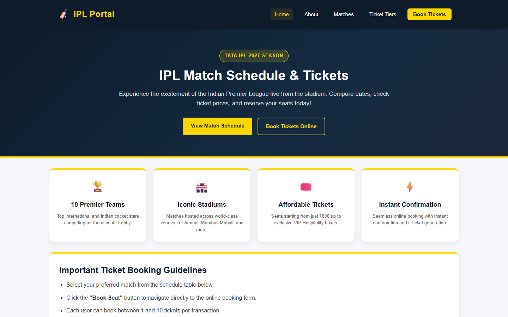
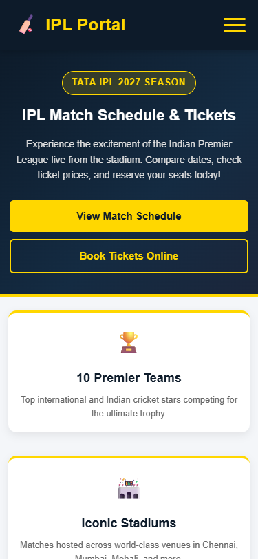
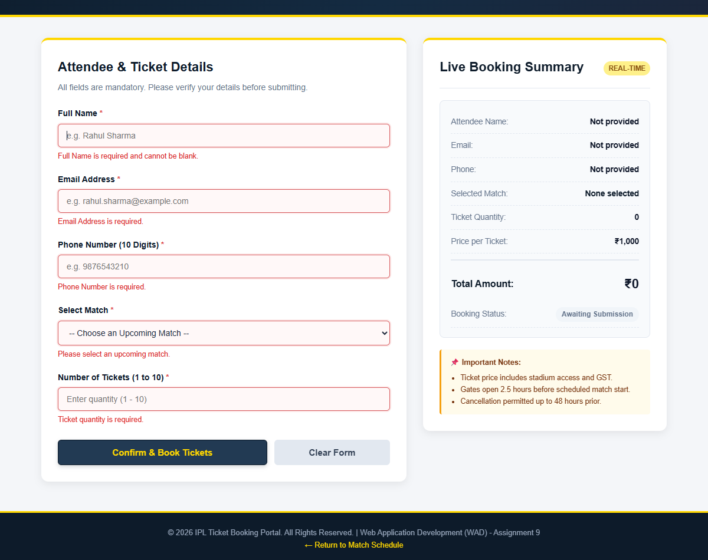
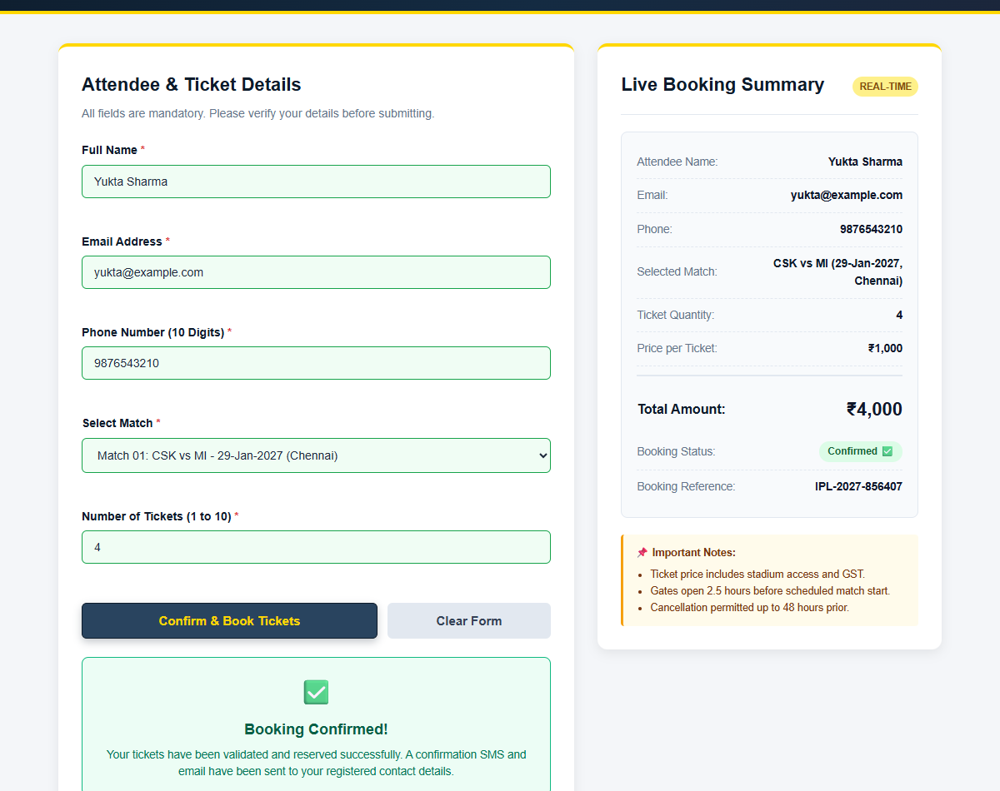

# Web Application Development (WAD) – Assignments 7, 8 & 9
### IPL Match Schedule and Ticket Booking Portal


**Student / GitHub Username:** [YUKTA2907](https://github.com/YUKTA2907)  
**Repository:** [WAD-Assignments-7-8-9](https://github.com/YUKTA2907/WAD-Assignments-7-8-9)  
**Course:** Web Application Development (WAD)  
**Theme:** IPL Classic Dark Blue (`#0d1b2a`, `#142b42`) &amp; Championship Gold (`#ffd700`)

---

## 📌 Project Overview

This repository contains the complete, verified, and production-tested solutions for **Web Application Development (WAD) Assignments 7, 8, and 9**. The project builds upon an IPL (Indian Premier League) Match Schedule and Ticket Booking web application, maintaining a cohesive dark-blue and gold aesthetic, clean modular code structure, and zero external framework bloat (pure semantic HTML5, CSS3, and vanilla modern JavaScript).

---

## 🚀 Assignments Summary

### 🏏 Assignment 7: IPL Match Schedule & Booking Buttons
- **Objective:** Preserve and structure the foundation files for IPL match schedule viewing and ticket booking.
- **Key Features:**
  - Preserved original `Matches-1-button.html` and `book-validation.html` files under `Assignment7/`.
  - Filter schedule by team (CSK, MI, RR, RCB) or show all matches.
  - Interactive "Book" button providing match details alert dialog.
  - Baseline ticket booking form layout and summary section.

---

### 📱 Assignment 8: Fully Responsive Website Across Breakpoints
- **Objective:** Transform the IPL portal into a responsive multi-device experience with Flexbox and CSS Grid layouts.
- **Key Features:**
  - **Responsive Navigation Bar (CSS Flexbox):**
    - Seamlessly aligns the IPL brand logo and navigation links.
    - Features a dedicated mobile hamburger toggle button for screens below 768px.
  - **Responsive Layout (CSS Grid & Flexbox):**
    - Tournament feature highlight cards adjust from a 4-column grid (desktop) to 2 columns (tablet) and 1 column (mobile).
    - Seating & ticket pricing cards adjust from 3 columns to 1 column on smaller screens.
  - **Horizontally Scrollable Schedule Table:**
    - Table wrapped inside `.table-container` with `overflow-x: auto;` and `-webkit-overflow-scrolling: touch;`.
    - Protected by `min-width: 650px` to prevent text squishing on mobile devices.
    - Includes a friendly mobile swipe indicator (`👉 Swipe horizontally to view full match details`).
  - **Media Query Breakpoints:**
    - **Desktop Layout:** Above `1024px` (tested at `1440px`).
    - **Tablet Layout:** `768px` to `1024px` (tested at `768px`).
    - **Mobile Layout:** Below `768px` (tested down to `375px`).
  - **Verified Screenshots:**
    - `Assignment8/screenshots/desktop.png` (1440px viewport)
    - `Assignment8/screenshots/mobile.png` (375px viewport)

---

### 🛡️ Assignment 9: Complete Client-Side Form Validation
- **Objective:** Build robust client-side validation for the IPL ticket booking form with real-time feedback, error messaging, and asynchronous processing simulation.
- **Key Features:**
  - **Full Name Validation:**
    - Required field, cannot contain only spaces.
    - Enforces letters and spaces only (`/^[A-Za-z\s]{2,50}$/`, min 2 characters).
  - **Email Address Validation:**
    - Required field with standard email pattern verification (`/^[^\s@]+@[^\s@]+\.[^\s@]+$/`).
  - **Phone Number Validation:**
    - Required field with strict 10-digit numerical verification (`/^[0-9]{10}$/`).
  - **Match Selection Validation:**
    - Mandatory dropdown selection from upcoming IPL matches.
  - **Ticket Quantity Validation:**
    - Required field, strictly integer values between 1 and 10 tickets per order.
  - **Dynamic Error Messages & Visual Feedback:**
    - Dedicated individual error containers below each field.
    - Invalid fields highlighted with red borders and subtle red tint (`.input-error`).
    - Validated fields highlighted in green (`.input-valid`).
    - Error messages automatically clear as soon as the user types or corrects the input.
  - **Real-Time Live Booking Summary:**
    - Receipt card dynamically calculates total amount (`Quantity × ₹1,000`) in real time.
    - Displays attendee name, contact details, selected fixture, and status.
  - **Submission Flow & Double-Submit Protection:**
    - Uses `event.preventDefault()` to stop unauthorized submissions.
    - Disables submit and reset buttons during processing to prevent duplicate submissions.
    - Shows an animated CSS loading spinner during simulation.
    - Displays a confirmed green success notification with an auto-generated Booking Reference (`IPL-2027-XXXXXX`).
  - **Verified Screenshots:**
    - `Assignment9/screenshots/validation.png` (Validation errors state)
    - `Assignment9/screenshots/success.png` (Successful booking confirmation state)
    - `Assignment9/screenshots/booking-history.png` (Booking History table and live statistics cards)

---

### 📋 Feature: IPL Booking History & Browser-Session Statistics
- **Objective:** Provide a persistent, transparent record of all successful ticket bookings made in the current browser session.
- **Key Features:**
  - **Summary Statistics Cards (5 Real-Time Metrics):**
    - **Total Bookings:** Count of successful checkout transactions.
    - **Total Tickets Sold:** Aggregate tickets booked across all transactions.
    - **General Category Bookings:** Count of General Stand bookings.
    - **Premium Category Bookings:** Count of Premium Pavilion bookings.
    - **VIP Category Bookings:** Count of VIP Hospitality bookings.
    - Metrics are computed directly from genuine stored records (never fabricated).
  - **Structured Booking History Table:**
    - Detailed columns: `Booking ID`, `Customer`, `Match`, `Category`, `Tickets`, `Total Amount`, `Booking Date & Time`, and `Status`.
    - Wrapped inside an `overflow-x: auto` container for seamless horizontal scrolling on mobile.
  - **LocalStorage Persistence:**
    - Preserves all confirmed booking records across page reloads.
    - Real-time updates immediately upon successful booking form submission.
    - Rejects invalid or incomplete form submissions from entering the history.
    - Includes a clear history control to reset browser storage on demand.

---

## 📂 Project Folder Structure

```text
WAD-Assignments-7-8-9/
├── .gitignore
├── README.md
│
├── Assignment7/
│   ├── Matches-1-button.html     # Preserved original match schedule & buttons
│   └── book-validation.html      # Preserved original ticket booking page
│
├── Assignment8/
│   ├── index.html                # Responsive IPL portal & match schedule
│   ├── style.css                 # External stylesheet with desktop, tablet & mobile media queries
│   └── screenshots/
│       ├── desktop.png           # Genuine screenshot at 1440px viewport
│       └── mobile.png            # Genuine screenshot at 375px viewport
│
└── Assignment9/
    ├── book-validation.html      # 2-column responsive ticket booking & receipt layout
    ├── style.css                 # Form styling, error states, spinner & success banners
    ├── script.js                 # Event listeners, regex validation, real-time summary & processing
    └── screenshots/
        ├── validation.png        # Genuine screenshot demonstrating validation errors
        └── success.png           # Genuine screenshot demonstrating confirmed submission
```

---

## 💻 Instructions to Run the Project Locally

### Option 1: Open Directly in Web Browser
1. Navigate to the project folder:
   ```text
   C:\Users\Admin\OneDrive\Desktop\WAD\Assignments\WAD-Assignments-7-8-9
   ```
2. Double-click any `.html` file to launch it in your default web browser:
   - For Assignment 7: Open `Assignment7/Matches-1-button.html`
   - For Assignment 8: Open `Assignment8/index.html`
   - For Assignment 9: Open `Assignment9/book-validation.html`

### Option 2: Run via VS Code Live Server
1. Open the folder `WAD-Assignments-7-8-9` in Visual Studio Code:
   ```bash
   code "C:\Users\Admin\OneDrive\Desktop\WAD\Assignments\WAD-Assignments-7-8-9"
   ```
2. If installed, right-click `Assignment8/index.html` or `Assignment9/book-validation.html` and choose **"Open with Live Server"**.
3. The website will open at `http://127.0.0.1:5500`.

---

## 📸 Screenshots Gallery

### Assignment 8: Desktop Layout (1440px Viewport)


### Assignment 8: Mobile Layout (375px Viewport)


### Assignment 9: Client-Side Validation Error States


### Assignment 9: Successful Booking & Live Receipt


---

## 🏆 Git Commit History

The repository was built with separate, clear commits following the specification:

1. `Assignment 7: Add IPL match schedule and booking buttons.`
2. `Assignment 8: Implement responsive layout and mobile design.`
3. `Assignment 9: Implement complete client-side form validation.`
4. `Add project documentation and screenshots.`

---

## 📜 Academic Integrity Note
Developed for the Web Application Development (WAD) coursework adhering to pure semantic HTML5, CSS3, and modern vanilla JavaScript standards.
